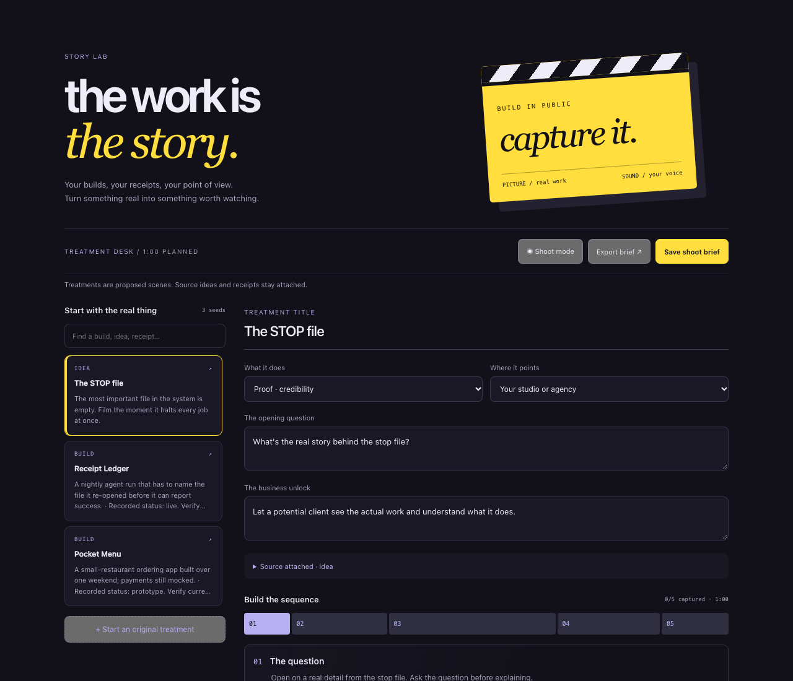
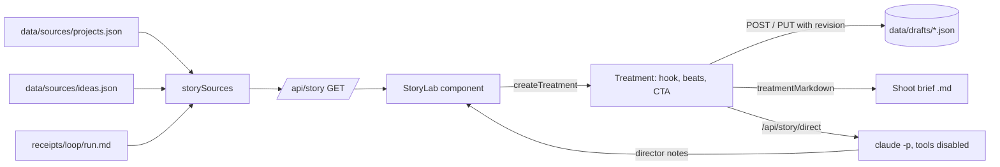

# Story Lab Shot Planner

A local web app that turns something you actually built into a shootable short video: pick a real project, idea or agent-run receipt, get a five-beat treatment with shot types, timings and cues, rehearse it against a timer in shoot mode, and export a shoot brief.



## Why

Build-in-public videos usually go wrong in one of two ways: a blank page, or a script that claims more than happened. Story Lab starts every treatment from a real source and keeps it honest. Beats are labelled as proposed scenes, cues tell you to hide client details and leave out outcomes you cannot verify, source claims travel with the brief, and the AI director is told never to invent footage, dialogue or results.

## Features

- **Start from real work.** Sources come from your own `projects.json`, a list of video ideas, and the newest non-idle receipt of each agent loop, all searchable in the left rail.
- **Five-beat treatments.** The question, the stakes, show the work, what holds up, leave a door open. Each beat has a title, shot type, duration and director's cue; reorder, add (up to 30), edit or delete.
- **Intent and destination.** Proof, process or position decides the business angle; the destination (studio, newsletter, portfolio) sets the call to action.
- **Runtime timeline.** A proportional strip of every beat with the total runtime and how many beats are captured.
- **Shoot mode.** A focused shot list with a countdown per beat, a rehearsal timer that advances through the sequence, and a captured checkbox for each shot.
- **Saved drafts with revisions.** Treatments save as JSON files written atomically. A revision number stops a stale window from overwriting a newer save, and a warning appears before leaving with unsaved edits.
- **Export.** Download the current treatment as a markdown shoot brief, or export a saved draft from the API with timecoded beats (`0–5s`, `5–17s`, ...).
- **AI director notes.** Sends the treatment and its source to Claude through the Claude Code CLI with every tool disabled, and drops editable notes under the treatment.
- **Validation everywhere.** Beat counts, field lengths, unique beat ids, known intents and destinations, and safe source links (`javascript:` and similar are rejected) are checked on the server before anything is written.

## How it works



`lib/treatment.mjs` holds the treatment model and the brief format, shared by the UI and the tests. `lib/drafts.mjs` reads sources and owns validation and atomic saves. `lib/director.mjs` builds the director prompt and runs the CLI. The Next.js routes are thin wrappers.

## Tech stack

- Next.js 15 (App Router) and React 19
- TypeScript for the UI and routes, plain ES modules for the logic
- Plain CSS, no UI framework
- `node:test` for tests
- Claude Code CLI (optional) for director notes

## Getting started

```bash
git clone https://github.com/ianroyes-sys/story-lab-shot-planner
cd story-lab-shot-planner
npm install
npm test           # 12 tests, no network
npm run dev        # http://localhost:3000
```

The app runs against the sample sources in `data/sources/`. To use your own, copy `.env.example` to `.env.local` and set:

| Variable | Purpose |
| --- | --- |
| `STORY_LAB_SOURCES` | folder with `projects.json` and `ideas.json` |
| `STORY_LAB_RECEIPTS` | folder of agent receipts (`<loop>/<run>.md` with `STATUS:` and `DID:` lines); try `examples/receipts` |
| `STORY_LAB_DRAFTS` | where treatments are saved (default `data/drafts`, git-ignored) |
| `STORY_LAB_KEY` | if set, required as an `x-story-lab-key` header or `story_lab_key` cookie |
| `STORY_LAB_CLAUDE_BIN`, `STORY_LAB_MODEL` | director notes; default `claude` and `opus` |

Director notes need the [Claude Code CLI](https://docs.anthropic.com/en/docs/claude-code) installed and signed in. Without it, the rest of the app works and the button reports that the director is unavailable.

Edit `DESTINATIONS` in `lib/treatment.mjs` to point calls to action at your own studio, newsletter or portfolio.

## Project structure

```
app/
  page.tsx               renders the Story Lab
  api/story/route.ts     sources + drafts (GET), save (POST), update (PUT), ?export=<id>
  api/story/direct/      AI director notes
components/
  StoryLab.tsx, .css     the treatment desk and shoot mode
lib/
  treatment.mjs          treatment model, runtime, shoot-brief markdown
  drafts.mjs             sources, validation, atomic saves, export
  director.mjs           director prompt + Claude Code CLI call
  server.ts              paths from env, local-only request guard
data/sources/            sample projects and ideas (fake)
examples/receipts/       sample agent receipt
test/                    node:test suites
docs/                    screenshot
```

## Status

Working local tool. It started as the Story tab of the Creative room in Ian's private Omega dashboard and was extracted into this standalone app; the sources and saved treatments here are samples, not his. It is meant to run on your own machine: there is no user system, and the optional key is the only access control.

Built by [Ian Royes](https://github.com/ianroyes-sys)
